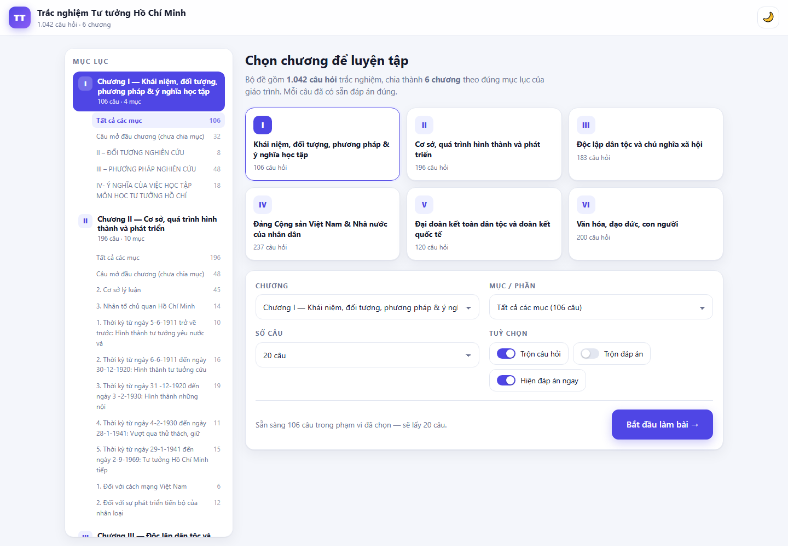
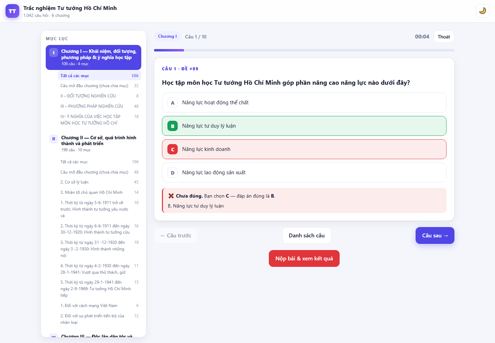
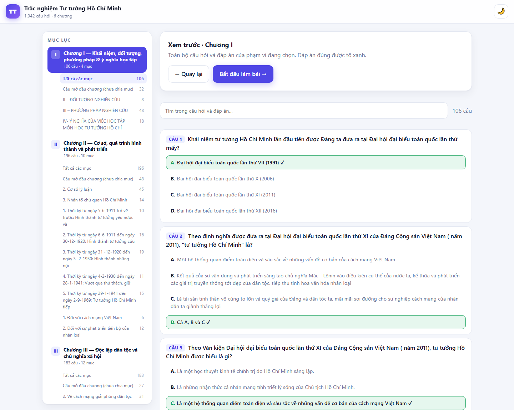
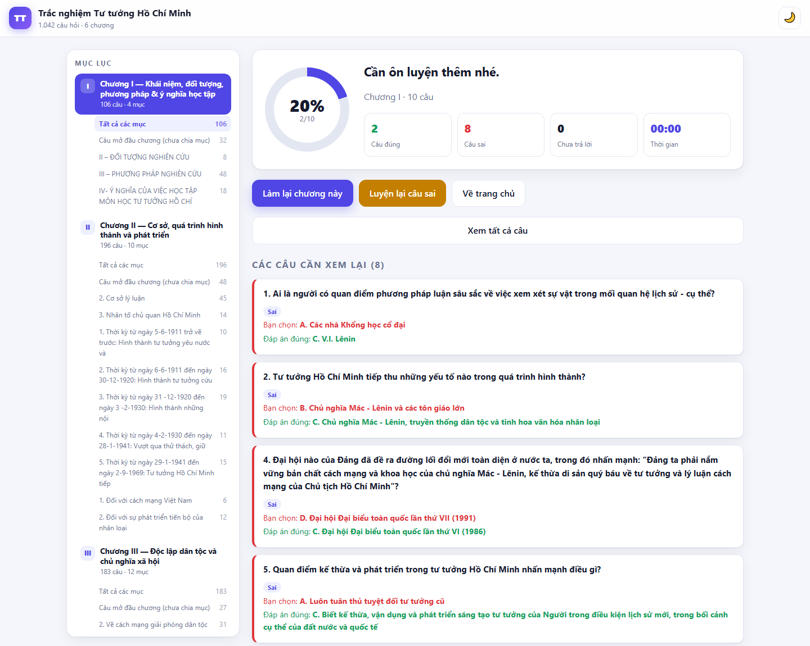
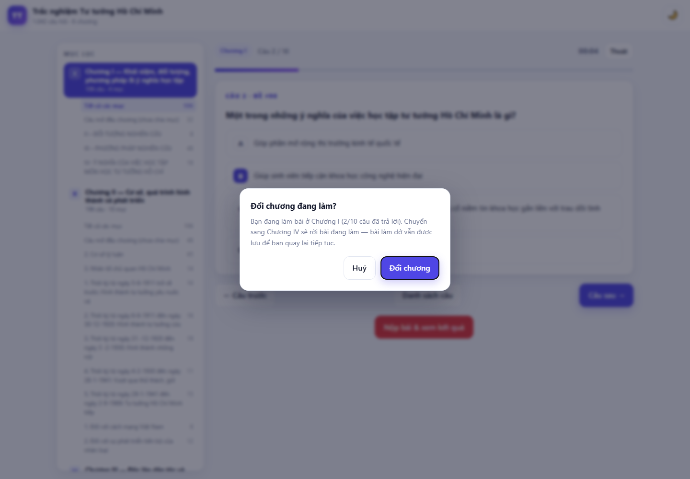
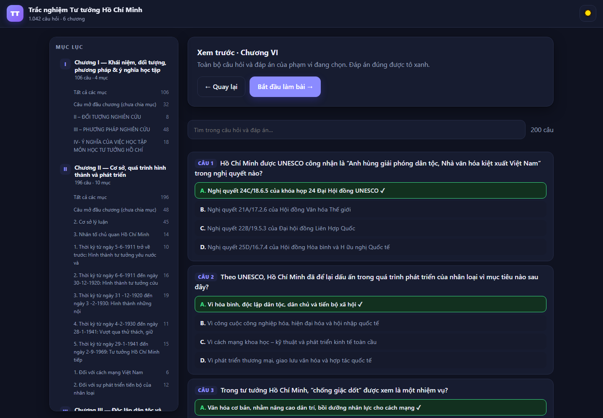

# Ôn trắc nghiệm Tư tưởng Hồ Chí Minh

Web luyện trắc nghiệm lấy trực tiếp từ file `BỘ ĐA MÔN TTHCM.pdf`.

## Cách dùng

Mở file **`web/index.html`** bằng trình duyệt (nháy đúp là được — không cần cài gì, không cần mạng).
Toàn bộ câu hỏi nằm sẵn trong `web/data.js` nên mở bằng `file://` vẫn chạy bình thường.

## Có gì

- **1.042 câu hỏi**, chia đúng **6 chương** theo mục lục của giáo trình:
  | Chương | Nội dung | Số câu |
  |---|---|---|
  | I | Khái niệm, đối tượng, phương pháp nghiên cứu và ý nghĩa học tập | 106 |
  | II | Cơ sở, quá trình hình thành và phát triển tư tưởng Hồ Chí Minh | 196 |
  | III | Độc lập dân tộc và chủ nghĩa xã hội | 183 |
  | IV | Đảng Cộng sản Việt Nam và Nhà nước của nhân dân, do nhân dân, vì nhân dân | 237 |
  | V | Đại đoàn kết toàn dân tộc và đoàn kết quốc tế | 120 |
  | VI | Văn hóa, đạo đức, con người | 200 |
- **Mục lục ở cột trái**: bấm vào từng chương, hoặc từng mục nhỏ bên trong chương, để giới hạn phạm vi ôn.
- **Chọn chương để hỏi**: ở trang chủ có 6 thẻ chương và 2 ô chọn *Chương* / *Mục – phần*.
- **Chọn số câu**: 10 / 20 / 30 / 50 / *Tất cả*, hoặc **Số khác…** để tự nhập số bất kỳ.
  Nhập nhiều hơn số câu đang có thì web tự lấy hết và báo trước.
- **Xem trước câu hỏi & đáp án**: nút *Xem trước câu hỏi & đáp án* ở trang chủ liệt kê toàn bộ câu hỏi
  của phạm vi đang chọn kèm **đáp án đúng tô xanh**, có ô tìm kiếm để lọc theo nội dung câu hỏi,
  đáp án hoặc mục. Từ màn hình đó có thể *Bắt đầu làm bài* luôn.
- **Tuỳ chọn khi làm bài**: trộn câu hỏi, trộn đáp án, hiện đáp án ngay.
- **Trong lúc làm**: đồng hồ, thanh tiến độ, nút Câu trước / Danh sách câu / Câu sau, phím tắt
  `1`–`4` hoặc `A`–`D` để chọn đáp án, `←` `→` để chuyển câu, `Thoát` để dừng giữa chừng.
- **Đổi phạm vi giữa chừng**: bấm một chương/mục khác trong lúc đang làm bài hoặc đang xem kết quả sẽ
  hiện hộp thoại xác nhận kèm tiến độ hiện tại; đồng ý thì chuyển hẳn sang phần đó (bài làm dở vẫn
  được giữ ở thanh *Tiếp tục*, bài đã nộp thì được xoá).
- **Kết quả**: điểm phần trăm, số câu đúng / sai / chưa trả lời, thời gian, và danh sách xem lại
  từng câu sai kèm đáp án đúng. Có nút *Luyện lại câu sai*.
- Tự lưu bài làm dở vào trình duyệt — lỡ đóng tab thì mở lại vẫn có nút *Tiếp tục*.
- Nút 🌙 / ☀️ ở góc phải để đổi nền sáng/tối.

## Ảnh chụp giao diện

| Trang chủ | Đang làm bài (hiện đáp án ngay) |
|---|---|
|  |  |

| Xem trước câu hỏi & đáp án | Kết quả |
|---|---|
|  |  |

| Hộp thoại xác nhận đổi chương | Nền tối |
|---|---|
|  |  |

## Đáp án lấy từ đâu

Trong file PDF gốc, **đáp án đúng của mỗi câu được in đậm**. Bộ trích xuất đọc đúng thuộc tính font
của từng ký tự để biết lựa chọn nào in đậm, thay vì đoán theo vị trí. Cách này xác định được đáp án
cho **cả 1.042/1.042 câu** (A: 215, B: 291, C: 358, D: 178).

## Cấu trúc thư mục

```
web/          ← sản phẩm: mở index.html
  index.html    khung trang
  style.css     giao diện (sáng/tối, co giãn cho điện thoại)
  app.js        toàn bộ logic làm bài
  data.js       ngân hàng câu hỏi (window.QUIZ_DATA)
build/        ← dữ liệu trung gian + ảnh chụp giao diện
  quiz.json     dữ liệu đã trích xuất
  toc.txt       mục lục lấy từ PDF
tools/        ← script dùng để tạo ra web/ (không cần khi chỉ dùng web)
  extract_final.py  PDF -> build/quiz.json
  make_data.py      quiz.json -> web/data.js
  validate.js       kiểm tra dữ liệu, đối chiếu id app.js <-> index.html
  domtest.js        chạy thử app.js trong DOM giả (domshim.js)
  make_shots.js     sinh trang HTML tạm để chụp ảnh bằng Chrome headless
```

## Kiểm thử

`tools/domtest.js` chạy `app.js` trong một DOM giả và mô phỏng 17 luồng sử dụng thật (chọn chương,
lọc mục nhỏ, chế độ hiện đáp án ngay, phím tắt, tự chuyển câu, thoát giữa chừng, nộp bài, xem lại,
luyện lại câu sai, đổi nền, tải lại trang giữa lúc làm và sau khi nộp, tự nhập số câu, xem trước,
tìm kiếm, và các hộp thoại xác nhận khi đổi phạm vi). Chạy lại sau mỗi lần sửa code.

## Nếu muốn trích xuất lại từ PDF

```powershell
$py = "C:\Users\dell\.dsh\dsh-runtimes\dsh-primary-runtime\dependencies\python\python.exe"
$env:PYTHONIOENCODING = "utf-8"
& $py tools\extract_final.py     # PDF  -> build\quiz.json
& $py tools\make_data.py         # quiz.json -> web\data.js
```

Kiểm tra lại sau khi sửa code:

```powershell
$node = "C:\Users\dell\.dsh\dsh-runtimes\dsh-primary-runtime\dependencies\node\bin\node.exe"
& $node tools\validate.js   # kiểm tra dữ liệu + đối chiếu id giữa app.js và index.html
& $node tools\domtest.js    # chạy thử app.js trong DOM giả, mô phỏng các luồng sử dụng
```
